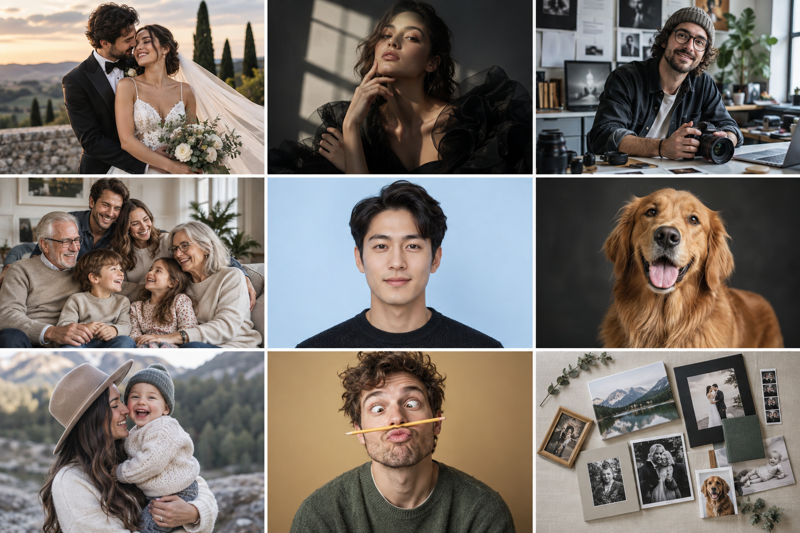

# 影像工坊

[English](./README.md) | 中文

## 项目简介

影像工坊是面向影楼和人像摄影团队的 Agent Skill。提供客户照片和需求，就能策划人像拍摄、比较方向、制作单张成片，或修改现有照片。它会尽量保留指定人物的可辨认特征，并在交付前检查结果。

主要覆盖证件照、婚纱照、全家福与亲子照、个人形象照和艺术写真；宠物写真、表情包和混合合集有轻量分流。

## 效果预览



这张 AI 生成的示意图说明支持范围，不是真实客户案例，也不代表各类照片的最终版式。

## 核心功能

| 能力 | 它能帮你做什么 |
| --- | --- |
| 创意人像选方向 | 用一张竖版九宫格比较婚纱照、个人形象照或艺术写真的方向，变化场景、动作、景别和造型。 |
| 全家福与亲子照选方向 | 用一张横版四宫格比较四种场景和活动，每格保留所有指定成员。 |
| 选中画格制作单张 | 根据认可的画格重新生成独立成片，保留场景与造型，并对照原始人物参考检查身份。 |
| 证件照 | 规格明确时按尺寸和底色输出一张文件；正式用途还需核对接收机构要求。 |
| 现有照片编辑 | 按要求调整背景、服装、摄影风格或局部精修，保护不需要改的部分。 |
| 质检与返修 | 检查人物、身形、留白、服装与场景匹配、无关人物和画格比例，再针对问题修改。 |
| 可选影楼套系 | 需要正式交付包时，建立任务记录、联系表、精确格式文件和交付检查。 |

## 安装

### 配置要求

做人像预览时，需要人物照片和可调用图片工具的 Agent；多格预览还会用到随仓库提供的 Python 拼图脚本。

| 项目 | 要求 |
| --- | --- |
| Agent 客户端 | 支持 Skill 的 Codex、Claude Code 或 OpenClaw。 |
| 图片生成 | Agent 可调用图片生成或编辑工具；仓库不内置图像模型。 |
| 人物参考 | 清晰的人物照片；正式证件照还需要接收渠道的最新要求。 |
| 多格拼图与精确格式 | 需要 Python 3.10+ 和 Pillow。 |

### 快速安装

把这句话发给 Agent：

```text
请检查核心环境，从 https://github.com/chemny/photo-studio 安装这个 Skill，并验证能否加载。缺少图片工具或权限请告诉我；可选图片服务等我提出需求时再配置。
```

实际生图能力取决于 Agent 客户端可用的工具。Python 辅助脚本使用跨平台路径；仓库 CI 检查 macOS、Windows 和 Linux。

## 快速开始

上传一张清晰的人像，然后说：

```text
用这张照片做个人形象照九宫格，给我不同但可信的场景、服装和动作，人物要像我。
```

你会得到一张选片预览图。比较场景和构图后，可以提出返修，或指定某格制作独立单张成片。

## 使用示例

- **婚纱照：**“用这两张人物参考做婚纱照九宫格。场景和动作要变化，两个人都要保持像本人。”
- **全家福：**“用这张全家合影做四个横版场景。每格都保留全部成员，活动不要重复。”
- **亲子照：**“用这张我和孩子的照片做亲子照四宫格。四格换不同活动，保留脸和年龄特征。”
- **证件照：**“根据这张照片做一张普通二寸蓝底证件照，保留五官和服装。”正式申请还需提供接收渠道最新的像素、文件大小和底色要求。
- **照片编辑：**“把这张照片的背景换成明亮摄影棚，保留我的脸、服装和姿势。”
- **穿搭方向：**“先把几种现代穿搭放在一张图里让我选；保留已经认可的场景和姿势，选定后再制作正式预览。”

## 工作原理

[主规则](./SKILL.md)识别照片产品，再读取 [`references/`](./references/) 中对应的规则。创意九宫格先分别生成 `3:4` 竖版画格；全家福和亲子照四宫格先分别生成 `4:3` 横版画格。[拼图脚本](./scripts/compose_grid.py)核对尺寸与比例后原像素拼接，不拉伸画格。选中的单张会重新生成，并对照原始人物参考及所选画格验收。

只想快速比较穿搭或风格时，可以先看一张探索用方向图。选定方向后，正式多格预览仍逐格制作和检查；返修保留已认可的人物、场景与姿势，只修改指定部分。

详细规范包括[证件照尺寸](./references/id-photo-size-map.md)、[婚纱照](./references/wedding-photo.md)、[全家福与亲子照](./references/family-portrait.md)、[个人形象照](./references/personal-branding.md)、[艺术写真](./references/artistic-portrait.md)、[摄影导演](./references/portrait-direction.md)和[现有照片编辑](./references/photo-editing.md)。只有正式套系任务才使用可选的建档和交付脚本。[流程回归用例](./references/workflow-acceptance.md)用于检查分流与对话行为。

## 目录结构

```text
photo-studio/
├── SKILL.md                  # Agent 主入口
├── references/               # 照片产品与质检规则
├── scripts/                  # 拼图、格式化及可选交付工具
├── assets/                   # 预设与业务示意图
├── agents/                   # Agent 配置
├── requirements.txt         # Python 辅助脚本依赖
├── README.md
├── README.zh.md
└── LICENSE
```

## 许可

本仓库采用 [MIT 协议](./LICENSE)。该协议不授予用户上传照片或第三方素材的使用权。

## 关于我

由 Neo Chen 维护。项目反馈请使用 [GitHub Issues](https://github.com/chemny/photo-studio/issues)。
